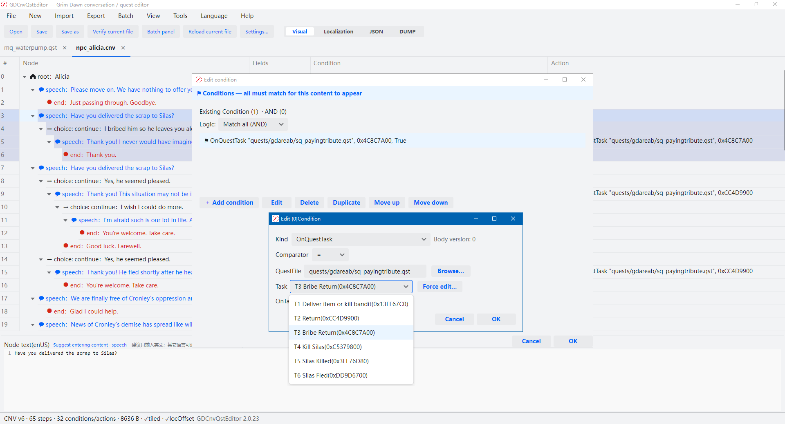
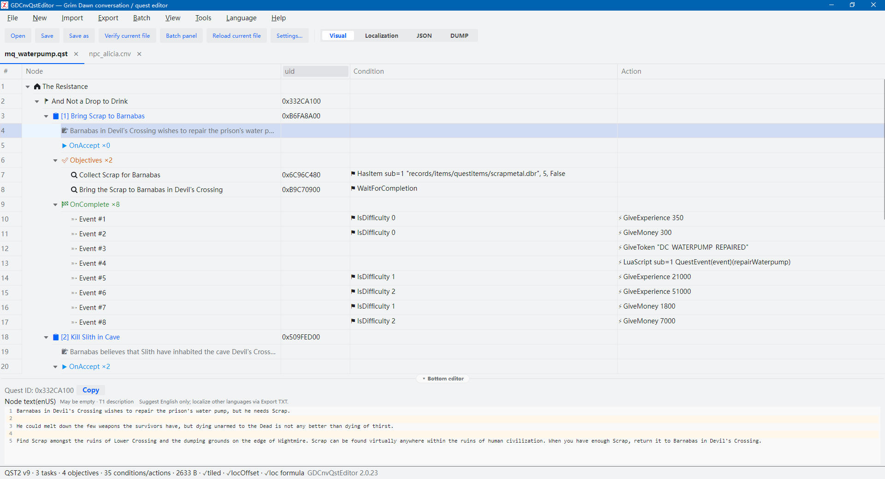
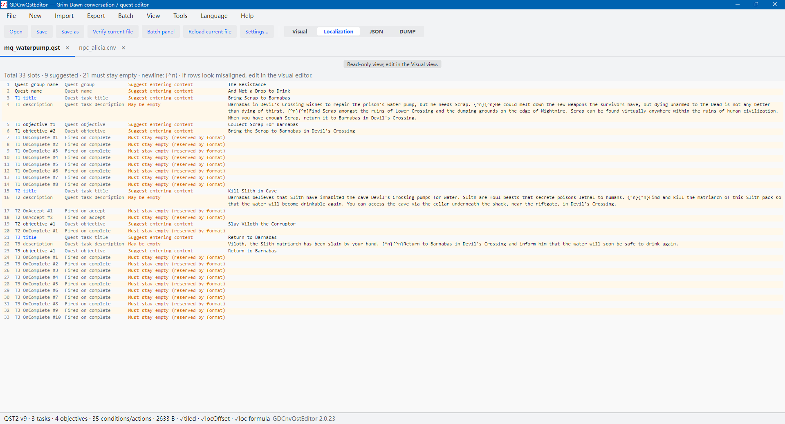
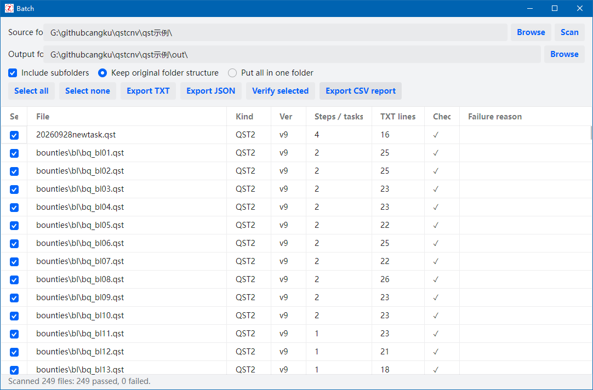
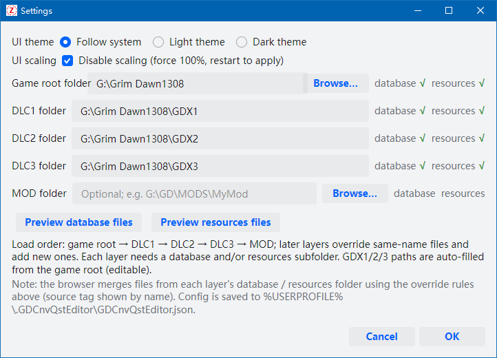
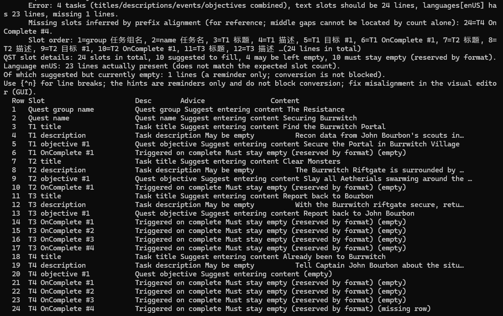
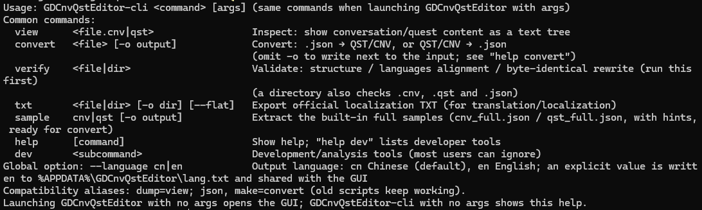

# GDCnvQstEditor

[简体中文](README.md) | **English**

> A third-party viewer, editor, generator, converter and validator for Grim Dawn conversation (`.cnv`) and
> quest (`.qst`) files. The GUI and CLI share one parser, and every write is guarded by
> "records fill the file / localization offset / byte-exact round-trip" checks.

GDCnvQstEditor is an open-source tool for quest authors, translators and format researchers. It offers a
flat, official-editor-like view of conversation trees and quest structures, lossless JSON conversion,
batch localization export, and structure validation for scripted pipelines.

> ⚠️ This is an **unofficial community tool**. It is **not affiliated with, authorized by, or endorsed by
> Crate Entertainment**, the developer of Grim Dawn. See [Copyright & Disclaimer](#copyright--disclaimer).



## Highlights

- **Two front ends**: run `GDCnvQstEditor.exe` with no arguments for the GUI, or with arguments for the
  full CLI. A standalone `GDCnvQstEditor-cli.exe` is also available for scripts and CI.
- **Flat structure editors**: CNV uses "node | properties | conditions | actions", QST uses
  "node | uid | conditions | actions". Nodes, conditions and actions can all be added, edited and removed;
  CNV's Index / linkId / text slots are renormalized automatically.
- **Four views** (toolbar, View menu, `Ctrl+1…4`, applied to every open tab):
  - **Visual**: structure table plus a bottom text editor, the only editable view; `{^n}` and real newlines
    are translated both ways.
  - **Localization**: merged view where the gutter shows node role, description and fill advice alongside
    the localized text.
  - **JSON**: the complete lossless model with syntax highlighting and folding.
  - **DUMP**: editor-style tree text for troubleshooting binary details.
- **Lossless JSON round-trip**: export `.cnv/.qst` to JSON, edit, and convert back byte-for-byte.
- **Localization workflow**: export official-format localization TXT, with per-slot guidance
  ("should fill / may be empty / must be empty").
- **Batch processing**: scan folders, select files, export TXT / JSON in bulk, validate and write a CSV report.
- **Safe writes**: re-parse and verify structure, localization offset and round-trip before saving; refuse to
  write when checks fail, and keep a `.bak` copy of the previous file.
- **Game folder integration**: configure the game root, GDX1/2/3 and MOD folders, then browse `database` /
  `resources` files with the same overlay order the game uses.
- **Chinese / English UI**: Chinese by default, switchable at runtime; language packs are `lang/*.json`,
  so adding a language needs no code changes.
- **Read-only protection**: files that fail parsing or integrity checks open read-only (viewable and
  exportable, but not savable).

## Screenshots

| CNV conversation editor | QST quest editor |
|---|---|
|  |  |
| **Merged localization view** | **Batch processing** |
|  |  |
| **Settings: theme / scaling / game folders** | **CLI verification details** |
|  |  |

CLI help overview:



## Download & Run

Download the latest package from the [Releases](../../releases) page. Release builds are produced by
[`publish.ps1`](publish.ps1) as two **framework-dependent single files**
(`dist/` is a build output and is not tracked):

| File | Purpose | Runtime |
|---|---|---|
| `GDCnvQstEditor.exe` | GUI; also runs the CLI when given arguments | [.NET 8 Desktop Runtime x64](https://dotnet.microsoft.com/download/dotnet/8.0) |
| `GDCnvQstEditor-cli.exe` | Pure command line, suitable for scripts / CI | .NET 8 Runtime x64 (included in Desktop Runtime) |

- No installation required. UI and view settings live in `%USERPROFILE%\.GDCnvQstEditor\`; the UI language is stored in `%APPDATA%\GDCnvQstEditor\lang.txt`.
- Single-file executables are occasionally flagged by antivirus software; whitelist them if needed.
- If UI scaling looks wrong, enable **Disable UI scaling** under Tools → Settings (forces 1×, takes effect
  after restart).

## Quick Start

1. **Open**: drag a `.cnv` / `.qst` file into the window, or press `Ctrl+O`. Dropping a folder opens the batch panel.
2. **Inspect and edit**: navigate with the tree on the left; the table on the right shows the flat structure.
   Select a row and edit its text in the bottom editor. Double-click condition / action cells to edit them.
3. **Validate**: press `F5` or use Tools → Validate Current File; the status bar reports structure, offset and
   round-trip results.
4. **Save**: `Ctrl+S`. The three checks run before writing and a `.bak` is created; read-only documents cannot be saved.
5. **Export / convert**: use the Export menu for official localization TXT, lossless JSON or DUMP; JSON can be
   re-imported later.

New Conversation (`Ctrl+N`) and New Quest (`Ctrl+Shift+N`) wizards create editable v6 / v9 skeletons.

## Command Line

```text
GDCnvQstEditor-cli <command> [arguments]
```

| Command | Description |
|---|---|
| `view <file.cnv\|qst>` | Show the conversation / quest as tree text (legacy alias `dump`) |
| `convert <file> [-o output]` | JSON ↔ CNV/QST in both directions; the direction is inferred from the extension and JSON kind |
| `verify <file\|dir>` | Validate structure, language-line alignment and byte-exact round-trip; folders also cover `.cnv/.qst/.json` |
| `txt <file\|dir> [-o dir] [--flat]` | Export official localization TXT for translation |
| `sample cnv\|qst [-o output]` | Extract the built-in full JSON example, ready for `convert` |
| `help [command]` | Command help; `help dev` lists research tools |
| `dev <subcommand>` | Reverse-engineering / format research tools (not needed by regular users) |

The global `--language cn|en` option switches CLI output language and shares the GUI's language setting.
Exit codes: `0` success, `1` failures found, `2` usage error.

```bash
# Validate a whole folder
GDCnvQstEditor-cli.exe verify JSON示例
# JSON -> binary, then convert back
GDCnvQstEditor-cli.exe convert JSON示例/qst_full.json -o qst_full.qst
GDCnvQstEditor-cli.exe convert qst_full.qst -o qst_roundtrip.json
# Export official localization text
GDCnvQstEditor-cli.exe txt qst示例 -o out_txt
```

> When invoked from PowerShell / cmd, the GUI executable may attach to the parent console and garble output.
> Prefer `GDCnvQstEditor-cli.exe`, or redirect output via `Start-Process -RedirectStandardOutput` / `cmd /c`.

### Generating from JSON

`convert` accepts two JSON shapes: the lossless model exported from a binary file, and a hand-written spec that
only describes what to create. Specs accept official condition / action names; see
[JSON转CNV.md](JSON转CNV.md) and [JSON转QST.md](JSON转QST.md) for field tables and examples.

```json
{ "format": "cnv", "speaker": "Alex",
  "rows": [
    { "level": 1, "kind": "speech", "text": "You finally came.", "flags": 0,
      "cond": [ { "HasToken": ["MY_TOKEN", 1] } ],
      "act":  [ { "GiveMoney": [500] } ] },
    { "level": 2, "kind": "continue", "text": "Continue" }
  ] }
```

- Conditions / actions may use official names, object form, or raw `{type, subType, args}`;
- When editing an existing quest, keep IDs: a root-level `id` is used when present, task / objective `uid`s
  are mandatory, and reference IDs inside conditions / actions must match the target file;
- Generated files go through the same three checks; the target is never overwritten on failure.

## Build from Source

Requires the [.NET 8 SDK](https://dotnet.microsoft.com/download/dotnet/8.0).

```bash
dotnet build GDCnvQstEditor.sln        # Debug by default, output under each project's bin/Debug
```

Create release binaries:

```powershell
.\publish.ps1
```

This produces `dist/GDCnvQstEditor.exe` and `dist/GDCnvQstEditor-cli.exe` (framework-dependent single files).

### GitHub release (maintainers, manual only)

Releases are created by [`.github/workflows/release.yml`](.github/workflows/release.yml), which only runs on
manual dispatch (`workflow_dispatch`) — pushes, tags and schedules never trigger it:

1. Set the same `<Version>` in `GDCnvQstEditor/GDCnvQstEditor.csproj` and
   `GDCnvQstEditor-cli/GDCnvQstEditor-cli.csproj`, commit and push. The version becomes the tag
   (`2.0.24` → `v2.0.24`).
2. In the repository, open **Actions → Release → Run workflow**; optionally mark the release as draft or
   pre-release.
3. The workflow reads the version, verifies both projects agree, refuses a tag already used by another commit
   (a re-run on the same commit reuses the tag), builds the changelog from the previous version tag up to the
   current commit (`First release` when no tag exists), runs `publish.ps1`, creates the `vX.Y.Z` tag and
   Release, and uploads both EXEs plus `SHA256SUMS.txt`.

## Project Layout

```text
GDCnvQstLib/           Parser and serializer (net8.0, shared by GUI and CLI)
  CnvFile / QstFile      binary models, parsing and writing
  Scriptable/            30 conditions, 27 usable actions, field tables
  Dump / TextExport      DUMP tree text, official localization TXT
  JsonIO / Creation      lossless JSON, hand-written spec, new-document factory
  Cli/                   CLI commands, batch operations, corpus census
GDCnvQstEditor/        Avalonia GUI (net8.0-windows)
GDCnvQstEditor-cli/    Thin command-line host
GdAssets/              Grim Dawn install model and layered file index
EditorProbe/           Read-only probe for the official editor assemblies (format research)
cnv示例/               Field vocabulary transcribed from the official editor
qst示例/               Self-made minimal QST sample and field notes
JSON示例/              Full JSON examples and hand-written template
screenshots/           README screenshots (Chinese / English)
```

## Compatibility & Verification

| Check | Result |
|---|---|
| CNV samples (v5 / v6) | 199 / 199 pass |
| QST2 samples (including multi-task bounties) | 248 / 248 pass |
| Pass criteria | records exactly fill the file + localization offset correct + byte-identical `Parse → Write` |
| QST localization slot formula | `2 + 2T + O + I + E`, zero errors across 248 samples |
| JSON round-trip | binary → JSON → binary is byte-identical (including logic flags) |
| TXT export | byte-identical to the existing v0.9 tool across all 447 samples |

Supported formats: CNV v5 / v6 and QST2 v9. Samples come from the game installation and are used only for
format research and regression testing.

## Documentation

| Document | Contents |
|---|---|
| [CnvQstFormatDecoded.md](CnvQstFormatDecoded.md) | Authoritative binary format document: structures, fields, condition / action tables and evidence |
| [JSON转CNV.md](JSON转CNV.md) | Hand-written JSON for conversations: fields, 30 conditions, 29 actions, examples |
| [JSON转QST.md](JSON转QST.md) | Hand-written JSON for quests: task / objective / event and slot rules |
| [cnvqst-wiki-user.md](cnvqst-wiki-user.md) | Feature overview, full condition / action parameter reference and CLI list |
| [JSON示例/](JSON示例/) | `cnv_full.json` / `qst_full.json` full examples |

The format work also draws on [R-Hidayatullah/gd-utility](https://github.com/R-Hidayatullah/gd-utility) (MIT),
which decompiled the game loader.

## UI Language Packs

Language packs are `lang/*.json` next to the executable (releases embed Chinese and English; a same-named file
on disk takes precedence):

```json
{ "code": "zh-CN", "name": "简体中文",
  "strings": { "Open": "打开", "Saved {0}": "已保存 {0}" },
  "types":   { "HasFaction": "阵营声望" } }
```

- Missing keys fall back to the English key; action / condition / node type names stay as fixed terms.
- To add a language, copy a JSON file, change `code` / `name` and the translations, and drop it into `lang/`;
  it appears in the Language menu automatically.

## Known Issues

- Single-file executables are occasionally flagged by antivirus software.
- Console output of the GUI executable can be captured by `AttachConsole` when calling the CLI (see above).
- Official audio assets are packed inside `.arc` files, so the voice-file picker showing an empty tree is normal.
- **Disable UI scaling** takes effect after a restart; at high DPI the UI is forced to 1× and may look slightly blurry.

## Contributing

Issues and pull requests are welcome. Run `dotnet build GDCnvQstEditor.sln` before submitting changes; UI text
changes must update both `GDCnvQstEditor/lang/zh-CN.json` and `en.json`. For binary-format problems, attach a
sample file and the `verify` output so the issue can be reproduced.

## Copyright & Disclaimer

- The source code is released under the [MIT License](LICENSE), Copyright © 2026 GDCnvQstEditor contributors.
- **This is an unofficial third-party tool. It has no affiliation, authorization, sponsorship or endorsement
  relationship with Crate Entertainment, the developer / publisher of Grim Dawn.**
- Grim Dawn, Crate Entertainment and related names, logos, game content and data files belong to their
  respective owners.
- The repository ships only self-made minimal samples (`JSON示例/`, `qst示例/20260928newtask.qst`) and field
  vocabulary transcribed from the official editor. No game data files are redistributed; game UI and text
  appearing in screenshots are for illustration only.
- Third-party components keep their own licenses, including Avalonia, Semi.Avalonia and AvaloniaEdit (MIT).
  `Avalonia.Controls.TreeDataGrid` is pinned to 11.0.10, the last MIT-licensed version (12+ is commercially licensed).
- You are responsible for the risks of modifying game files; always keep backups.
