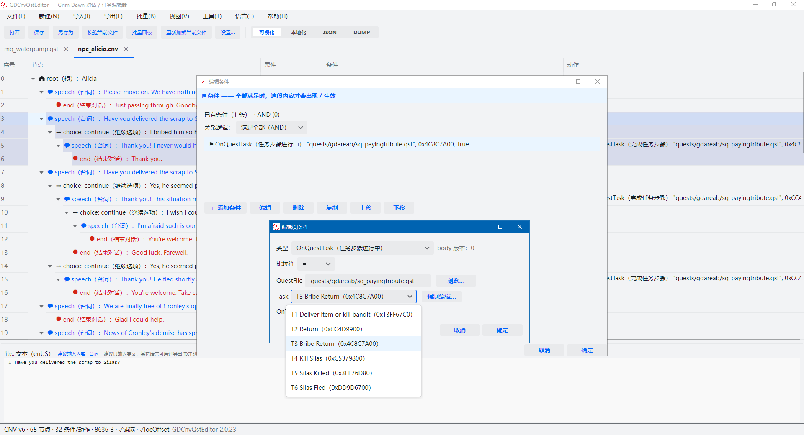
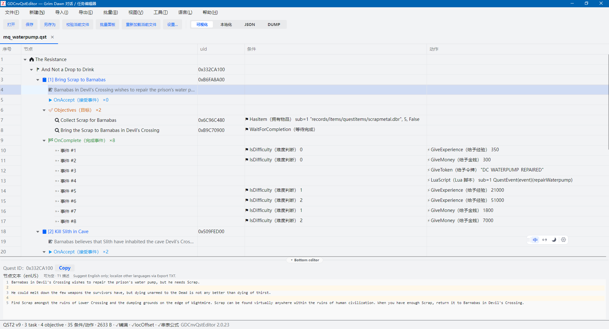
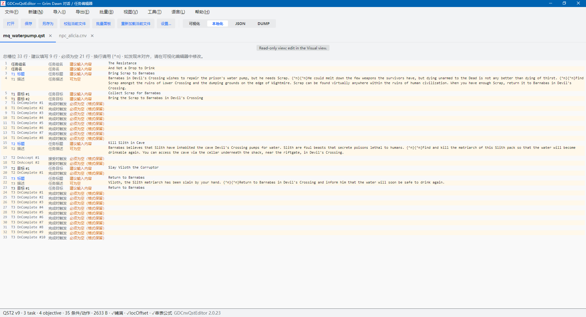
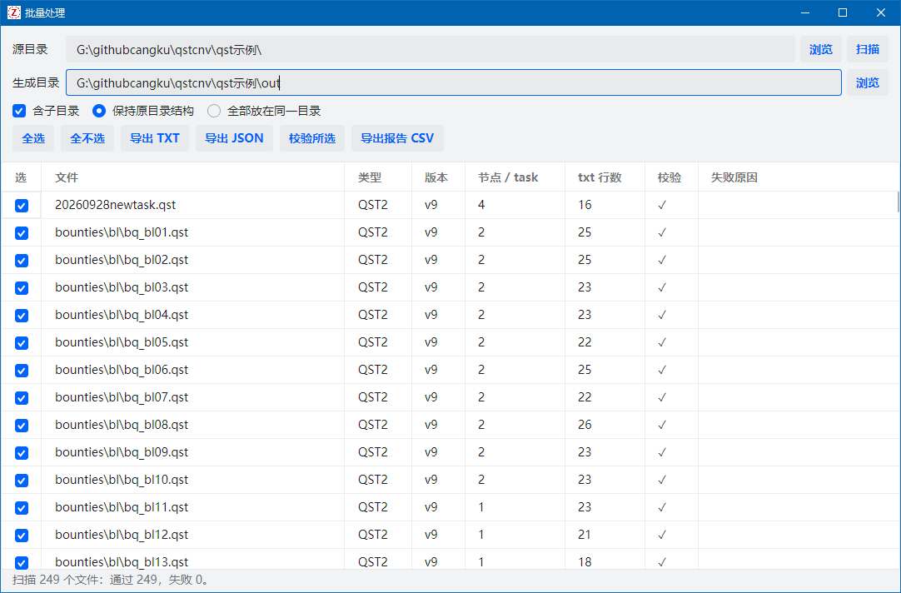
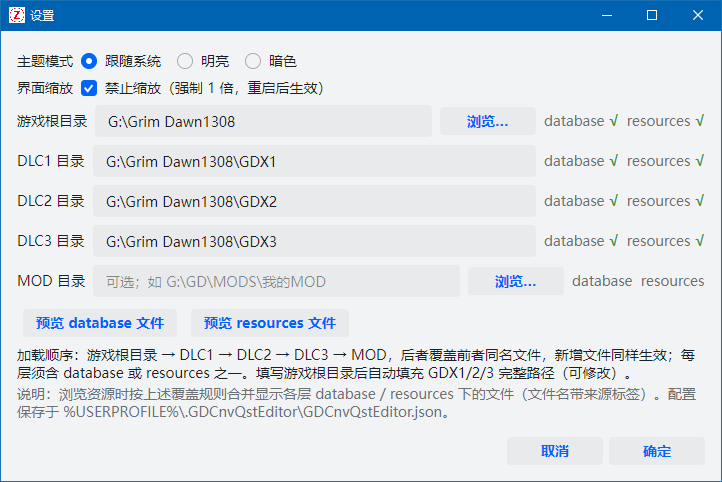
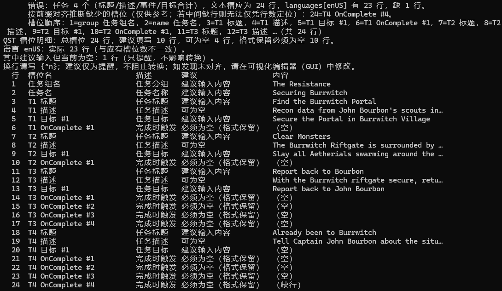
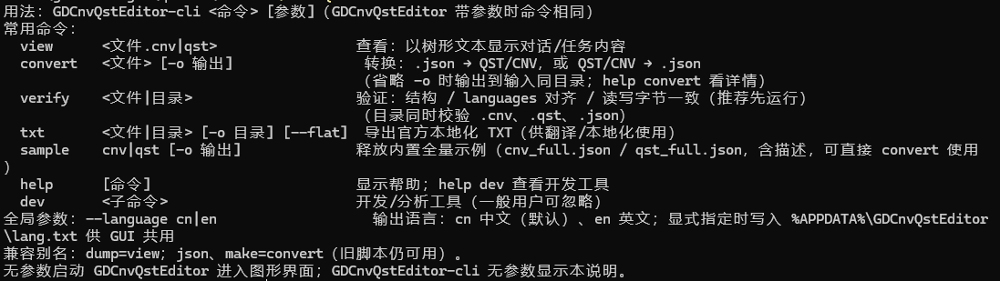

# GDCnvQstEditor

**简体中文** | [English](README-EN.md)

> 《恐怖黎明》（Grim Dawn）对话（`.cnv`）与任务（`.qst`）文件的第三方查看 / 编辑 / 新建 / 转换 / 校验工具。
> 图形界面与命令行共用同一套解析库，读写经「铺满文件 / 本地化偏移 / 逐字节 round-trip」三重校验。

GDCnvQstEditor 是一个面向任务作者、翻译者与格式研究者的开源工具：既能像官方编辑器一样平铺编辑对话树与任务结构，
也能把二进制文件无损转成 JSON、批量导出本地化 TXT，或在脚本流水线里做结构校验。

> ⚠️ 本项目为**非官方社区工具**，与《恐怖黎明》开发商 **Crate Entertainment 无关**，未获其授权或认可。
> 详见文末[版权与免责声明](#版权与免责声明)。



## 功能亮点

- **双形态**：`GDCnvQstEditor.exe` 无参数进入图形界面；带参数时复用完整 CLI。另有纯命令行版 `GDCnvQstEditor-cli.exe`。
- **平铺结构编辑器**：CNV 为「节点 | 属性 | 条件 | 动作」，QST 为「节点 | uid | 条件 | 动作」。
  节点、条件、动作均可增删改，编辑结果实时回填；CNV 的 Index / linkId / 文本槽由内置重排保持一致。
- **四视图**（工具条 / 视图菜单 / `Ctrl+1…4`，对所有页签生效）：
  - **可视化**：结构表格 + 底部节点文本编辑器，唯一可编辑视图；`{^n}` 与真实换行双向转译。
  - **本地化**：合并视图，行号列同时标注节点角色、说明与填写建议，正文为本地化文本。
  - **JSON**：完整全保真模型，语法着色与折叠。
  - **DUMP**：编辑器风格树形文本，便于排查格式细节。
- **JSON 双向互转**：`.cnv/.qst → JSON` 全保真导出；手写 JSON → `.cnv/.qst`，适合批量生成与版本管理。
- **本地化工作流**：导出与官方格式一致的本地化 TXT；内置槽位明细，明确「建议填写 / 可为空 / 必须为空」。
- **批量处理**：扫描目录、勾选子集、批量导出 TXT / JSON、批量校验并导出 CSV 报告。
- **安全写盘**：保存前自动重解析并校验结构、本地化偏移与 round-trip；校验不过拒绝落盘，已有文件先备份 `.bak`。
- **游戏目录集成**：设置游戏根目录与 GDX1/2/3、MOD 目录后，可按叠加覆盖规则浏览 `database` / `resources` 文件。
- **中英界面**：默认中文，可即时切换英文；语言包为 `lang/*.json`，新增语言无需改代码。
- **只读保护**：解析失败或完整性检查不过的文件以只读方式打开，可查看、可导出，不可保存。

## 界面截图

| CNV 对话编辑 | QST 任务编辑 |
|---|---|
|  |  |
| **本地化合并视图** | **批量处理** |
|  |  |
| **设置：主题 / 缩放 / 游戏目录** | **CLI 校验明细** |
|  |  |

CLI 帮助总览：



## 下载与运行

发布版由 [`publish.ps1`](publish.ps1) 生成两个**框架依赖单文件**（`dist/` 为构建产物，不入库）：

| 文件 | 用途 | 运行时要求 |
|---|---|---|
| `GDCnvQstEditor.exe` | 图形界面；带参数时也执行 CLI | [.NET 8 Desktop Runtime x64](https://dotnet.microsoft.com/download/dotnet/8.0) |
| `GDCnvQstEditor-cli.exe` | 纯命令行，适合脚本 / CI | .NET 8 Runtime x64（Desktop Runtime 已包含） |

- 无需安装，双击即可运行；界面与视图配置保存在 `%USERPROFILE%\.GDCnvQstEditor\`，界面语言另存于 `%APPDATA%\GDCnvQstEditor\lang.txt`。
- 单文件 EXE 可能被杀毒软件误报，请按需加入白名单。
- 界面缩放异常时可在「工具 → 设置」勾选**禁止缩放**（强制 1 倍，重启生效）。

## 快速上手

1. **打开**：把 `.cnv` / `.qst` 拖进窗口，或按 `Ctrl+O`；拖入目录会直接打开批量面板。
2. **查看与编辑**：左侧树定位节点，右侧表格平铺展示；选中行后在底部编辑器修改文本。
   条件 / 动作在对应列双击或通过弹窗编辑。
3. **校验**：按 `F5` 或「工具 → 校验当前文件」，状态栏会显示结构、偏移与 round-trip 结果。
4. **保存**：`Ctrl+S`。写盘前自动三检查并生成 `.bak`；只读文档禁止保存。
5. **导出 / 转换**：菜单「导出」可得到官方本地化 TXT、全保真 JSON 或 DUMP；JSON 也可重新导入。

CNV 新建（`Ctrl+N`）与 QST 新建（`Ctrl+Shift+N`）提供向导，生成可继续编辑的 v6 / v9 骨架。

## 命令行

```text
GDCnvQstEditor-cli <命令> [参数]
```

| 命令 | 说明 |
|---|---|
| `view <文件.cnv\|qst>` | 以树形文本查看对话 / 任务内容（旧名 `dump` 仍可用） |
| `convert <文件> [-o 输出]` | JSON ↔ CNV/QST 互转；方向由输入扩展名与 JSON 声明自动判断 |
| `verify <文件\|目录>` | 结构、语言行数对齐、读写字节一致性校验；目录可同时校验 `.cnv/.qst/.json` |
| `txt <文件\|目录> [-o 目录] [--flat]` | 导出官方本地化 TXT（供翻译 / 本地化） |
| `sample cnv\|qst [-o 输出]` | 释放内置全量 JSON 示例，可直接用于 `convert` |
| `help [命令]` | 命令帮助；`help dev` 查看开发 / 分析工具 |
| `dev <子命令>` | 逆向与格式研究工具（一般用户可忽略） |

全局参数 `--language cn|en` 切换 CLI 输出语言，与 GUI 语言设置共用。退出码：`0` 成功、`1` 存在失败项、`2` 用法错误。

```bash
# 批量校验并导出报告
GDCnvQstEditor-cli.exe verify cnv示例
# 二进制 → JSON，修改后再转回
GDCnvQstEditor-cli.exe convert qst示例/mq_burrwitch.qst -o mq.json
GDCnvQstEditor-cli.exe convert mq.json -o mq_new.qst
# 导出官方格式本地化文本
GDCnvQstEditor-cli.exe txt qst示例 -o out_txt
```

> GUI EXE 在 PowerShell / cmd 中直接调用 CLI 时，输出可能被 `AttachConsole` 接管而回显异常；
> 脚本中建议使用 `GDCnvQstEditor-cli.exe`，或通过 `Start-Process -RedirectStandardOutput` / `cmd /c` 调用。

### 由 JSON 生成

`convert` 接受两类 JSON：全保真模型（由二进制导出）与手写 spec（只描述要写什么）。
手写 spec 支持官方条件 / 动作名，字段表与示例见 [JSON转CNV.md](JSON转CNV.md) / [JSON转QST.md](JSON转QST.md)。

```json
{ "format": "cnv", "speaker": "Alex",
  "rows": [
    { "level": 1, "kind": "speech", "text": "你终于来了。", "flags": 0,
      "cond": [ { "HasToken": ["MY_TOKEN", 1] } ],
      "act":  [ { "GiveMoney": [500] } ] },
    { "level": 2, "kind": "continue", "text": "继续" }
  ] }
```

- 条件 / 动作可写官方名、对象形式或原始 `{type, subType, args}` 形态；
- 修改既有任务时必须保留 ID：QST 根级 `id` 写了就用，task / objective 的 `uid` 不可省略，条件动作里的引用 ID 需照抄目标文件；
- 生成后同样经过三重校验，不通过不会覆盖目标文件。

## 构建

需要 [.NET 8 SDK](https://dotnet.microsoft.com/download/dotnet/8.0)。

```bash
dotnet build GDCnvQstEditor.sln        # 默认 Debug，输出到各工程 bin/Debug
```

一键生成发布包：

```powershell
.\publish.ps1
```

产出 `dist/GDCnvQstEditor.exe` 与 `dist/GDCnvQstEditor-cli.exe`（框架依赖单文件）。

## 工程结构

```text
GDCnvQstLib/           解析与序列化库（net8.0，GUI/CLI 共用）
  CnvFile / QstFile      二进制模型与解析 / 写回
  Scriptable/            30 种条件、27 个可用动作的类型与字段表
  Dump / TextExport      DUMP 树形文本、官方本地化 TXT
  JsonIO / Creation      全保真 JSON、手写 spec、新建工厂
  Cli/                   CLI 命令、批量操作与语料普查
GDCnvQstEditor/        Avalonia GUI（net8.0-windows）
GDCnvQstEditor-cli/    命令行薄壳
GdAssets/              Grim Dawn 安装目录模型与跨层文件索引
EditorProbe/           官方编辑器程序集只读探针（格式研究用）
cnv示例/ qst示例/       447 个真实样本（CNV 199 + QST 248）
JSON示例/              全量 JSON 示例与手写模板
scripts脚本示例/        任务 Lua 脚本参考语料
screenshots/           README 截图（中文 / 英文）
```

## 兼容性与验证

| 项目 | 结果 |
|---|---|
| CNV 样本（含 v5 / v6） | 199 / 199 通过 |
| QST2 样本（含多任务赏金） | 248 / 248 通过 |
| 通过标准 | 记录恰好铺满文件 + 本地化偏移正确 + `Parse → Write` 逐字节一致 |
| QST 本地化槽位公式 | `2 + 2T + O + I + E`，248 个样本零误差 |
| JSON 往返 | 二进制 → JSON → 二进制逐字节一致（含 logic 字保真） |
| TXT 导出 | 与既有 v0.9 工具输出在全部 447 个样本上逐字节一致 |

支持格式：CNV v5 / v6，QST2 v9。样本来自游戏安装目录，仅用于格式研究与回归测试。

## 文档

| 文档 | 内容 |
|---|---|
| [CnvQstFormatDecoded.md](CnvQstFormatDecoded.md) | 二进制格式权威文档：结构、字段、条件 / 动作表与证据链 |
| [JSON转CNV.md](JSON转CNV.md) | 手写 JSON 生成对话：字段表、30 种条件、29 种动作、示例 |
| [JSON转QST.md](JSON转QST.md) | 手写 JSON 生成任务：task / objective / event 与槽位规则 |
| [cnvqst-wiki-user.md](cnvqst-wiki-user.md) | 功能总览、条件 / 动作参数全量参考与 CLI 命令清单 |
| [JSON示例/](JSON示例/) | `cnv_full.json` / `qst_full.json` 全量示例 |

格式结论同时参考了 [R-Hidayatullah/gd-utility](https://github.com/R-Hidayatullah/gd-utility)（MIT）对游戏加载器的解析。

## 界面语言包

语言包是 EXE 旁 `lang/*.json`（发布版已内嵌中英文，磁盘同名文件优先）：

```json
{ "code": "zh-CN", "name": "简体中文",
  "strings": { "Open": "打开", "Saved {0}": "已保存 {0}" },
  "types":   { "HasFaction": "阵营声望" } }
```

- 缺 key 时回退英文 key；动作 / 条件 / 节点类型等固定术语不进入 `strings` 字典；
- 新增语言：复制一份 JSON，修改 `code` / `name` 与译文，放入 `lang/` 即出现在「语言」菜单。

## 已知事项

- 单文件 EXE 偶发杀毒软件误报。
- GUI EXE 直接调用 CLI 时的控制台接管问题（见上文命令行一节）。
- 官方音频资源打包在 `.arc` 内，配音选择弹窗中目录为空属正常现象。
- 「禁止缩放」重启后生效；高缩放屏上按钮与文字会略模糊（位图拉伸）。

## 贡献

欢迎提交 Issue 与 Pull Request。修改代码前请先运行 `dotnet build GDCnvQstEditor.sln`；
涉及界面文本的改动需同步 `GDCnvQstEditor/lang/zh-CN.json` 与 `en.json`。
二进制格式相关问题请附样本文件与 `verify` 输出，便于复现。

## 版权与免责声明

- 本项目源代码以 [MIT 许可证](LICENSE) 发布，Copyright © 2026 GDCnvQstEditor contributors。
- **本项目是非官方第三方工具，与 Grim Dawn 的开发商 / 发行商 Crate Entertainment（玩家常称「板条箱」）没有任何隶属、授权、赞助或背书关系。**
- Grim Dawn、Crate Entertainment 及相关名称、标识、游戏内容与数据文件归其各自权利人所有。
- 仓库内 `cnv示例/`、`qst示例/`、`scripts脚本示例/` 等游戏数据样本仅用于格式兼容性研究与回归测试，
  不构成对游戏内容的再授权；游戏本体及运行所需资源需自行合法取得。
- 本项目依赖的第三方组件遵循各自许可证，包括 Avalonia、Semi.Avalonia、AvaloniaEdit（MIT）等；
  `Avalonia.Controls.TreeDataGrid` 固定使用最后的 MIT 版本 11.0.10（12 及以上为商业授权）。
- 使用本工具修改游戏文件的风险由使用者自行承担，请务必保留备份。
